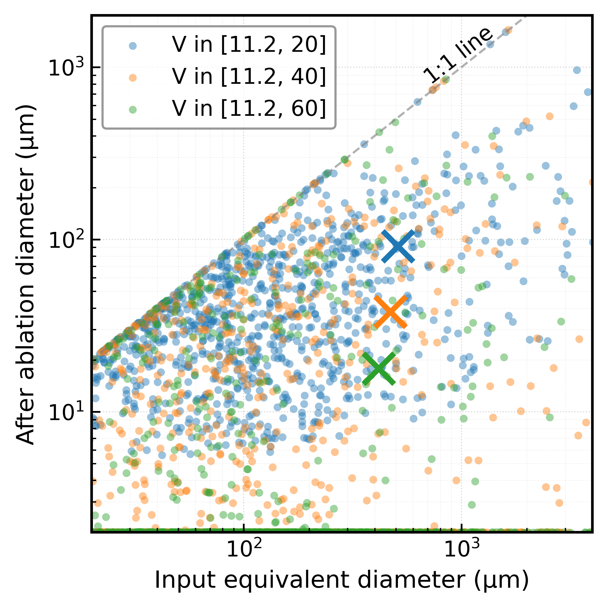

# Data and Model Availability

This repository contains the model outputs and supporting data associated with the manuscript:

> Chen, D., Catling, D. C., Buick, R., Brownlee, D., & Unruh, J. (2026).
> *Identifying Fossilized Precambrian Iron-type Cosmic Spherules in Carbonate Rocks: Challenges and Opportunities.*
> Currently under review at *Journal of Geophysical Research: Planets*.

The formal citation and DOI will be updated once the manuscript is published online.

## Main Results

### Effects of Entry Velocity on Cosmic Spherule Size

We investigated how the initial entry velocity affects the final diameter of iron-type cosmic spherules (ICSs) using a Monte Carlo approach.

Simulations were conducted under a 1-bar, pure N₂ atmosphere to isolate the effects of atmospheric ablation without oxidation. For each simulation, the initial particle size, entry angle, and entry velocity were randomly sampled, while different initial velocity ranges were considered.

The results show that higher entry velocities generally lead to greater atmospheric heating and more extensive ablation, resulting in smaller average final particle diameters.

  

  <em>
    Figure 1. Monte Carlo simulations of iron-type cosmic sphere
    entry under a 1-bar pure N₂ atmosphere. Initial particle sizes,
    entry angles, and velocities were randomly sampled across
    different velocity ranges. Crosses (×) indicate the mean
    final particle diameter.
  </em>

